<div align="center">

# 📈 Live Stock Trades: a real-time ELT pipeline

**Streams live US stock trades from Finnhub, stores every tick in PostgreSQL, caches live prices in Redis,
rolls ticks up into one-minute candles, and serves them through a secured REST API and a live dashboard.
It runs as six Docker containers and is covered by about 400 automated tests.**

[](https://github.com/siarkonyar/elt-dbt-phyton-data-pipeline/actions/workflows/ci.yml)


<br/>

[](#-tech-stack)

</div>

---

## 📚 Contents

1. [What it does](#-what-it-does)
2. [Architecture](#-architecture)
3. [Tech stack](#-tech-stack)
4. [The life of one trade](#-the-life-of-one-trade)
5. [The services, one by one](#-the-services-one-by-one)
6. [Data model](#-data-model)
7. [Engineering decisions](#-engineering-decisions)
8. [Testing](#-testing)
9. [CI/CD pipeline](#-cicd-pipeline)
10. [Run it yourself](#-run-it-yourself)
11. [Configuration](#-configuration)
12. [Project structure](#-project-structure)
13. [Known limits and next steps](#-known-limits-and-next-steps)

---

## 🎯 What it does

| | |
|---|---|
| ⚡ **Extract** | Opens a WebSocket to [Finnhub](https://finnhub.io) and receives every trade for `AMZN`, `NVDA`, `GOOGL`, `TSLA` and `NFLX` as it happens. |
| 💾 **Load** | Writes the raw trades into PostgreSQL in small batches, once a second. Nothing is changed on the way in. |
| 🕯️ **Transform** | A separate service turns raw trades into **one-minute OHLCV candles** (open, high, low, close, volume). |
| 🟥 **Cache** | Keeps each symbol's latest price and day stats in **Redis**, so the dashboard can refresh every second without hitting the database. |
| 🔐 **Serve** | A **FastAPI** service with JWT login, user roles and price alerts. |
| 📊 **Show** | A **Streamlit** dashboard: live price cards, candlestick charts, price alerts and a pipeline health page. |
| 🔔 **Alert** | Users set "tell me when NVDA goes above $X". The stream checks every incoming trade against every open alert. |

> **Why "ELT" and not "ETL"?** Data is **E**xtracted and **L**oaded raw first. The **T**ransform step runs
> later, inside the warehouse, on data that is already stored. If the transform has a bug, you fix it and
> re-run it. The raw trades are never lost.

---

## 🏗 Architecture

Six containers on one Docker network. **PostgreSQL is the source of truth.** Redis is only a fast copy
that can be rebuilt from Postgres at any time.

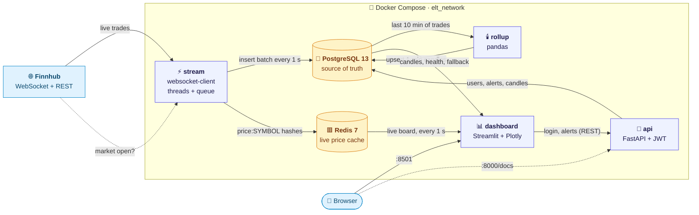

| Container | Kind | Runs | Port |
|---|---|---|---|
| `stream` | long-running worker | Finnhub WebSocket → Postgres + Redis, live alert checks | – |
| `rollup` | scheduled worker (every 60 s) | raw trades → one-minute candles | – |
| `api` | web service | FastAPI on Uvicorn | `8000` |
| `dashboard` | web app | Streamlit | `8501` |
| `destination_postgres` | database | PostgreSQL 13 with a named volume | `5434` |
| `redis` | cache | Redis 7, no persistence, localhost only | `6379` |

---

## 🧰 Tech stack

Every tool below is used for a specific job. The last column says why I picked it.

| Layer | Technology | What it does here | Why this choice |
|---|---|---|---|
| **Language** |  | All four services, the tests, and CI helper scripts | One language end to end. Rich data and web libraries. |
| **Data source** |  | WebSocket for live trades, REST for market open/closed status | Free real-time US equity trades over a WebSocket |
| **Streaming** |  `threading` `queue` | A socket thread receives trades; the main thread writes them | The socket never waits on the database, so a slow write can't drop trades |
| **Database** |  | Raw trades, candles, users, alerts, run logs | ACID transactions, `ON CONFLICT` upserts, exact `NUMERIC` prices, `DISTINCT ON` |
| **Cache** |  | One hash per symbol holding the live price and day stats | Reads in under a millisecond, so the board can refresh every second |
| **DB access** |  + psycopg2 | Connection pooling, transactions, parameterised SQL | Plain SQL I can read and tune, with safe parameter binding (no SQL injection) |
| **Transform** |  | Groups trades into OHLCV candles | A pure function that is very easy to unit test |
| **API** |    | REST endpoints, request validation, auto-generated OpenAPI docs | Type-checked input, dependency injection that is easy to swap in tests |
| **Auth** |   | Stateless login tokens, salted password hashes | Industry-standard and well-understood |
| **Frontend** |   | Multi-page dashboard, candlestick charts, timed partial refreshes | A full interactive UI in pure Python |
| **Containers** |  | One image per service, health checks, start-up order | The whole system starts with one command |
| **Testing** |    | Unit, integration and end-to-end tests; a fake Finnhub server | Tests the real containers, wired the same way as production |
| **Quality** |   | Linting, import sorting, coverage per service | Fast, and one tool replaces several |
| **CI** |  | Lint → 4 parallel test lanes → end-to-end | A reusable workflow, real Postgres and Redis service containers |

---

## 🔄 The life of one trade

What happens in the roughly 60 seconds after someone buys an NVDA share:

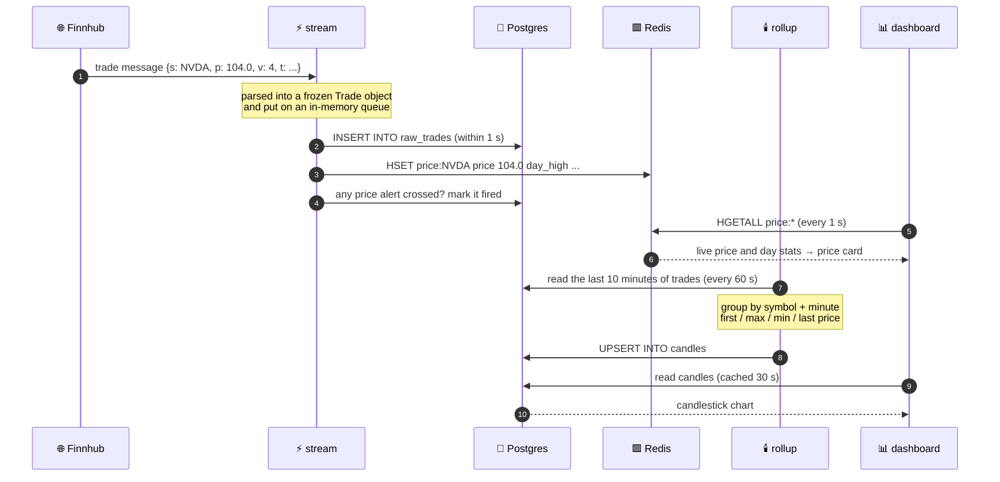

---

## 🧩 The services, one by one

### ⚡ `stream`: the extract and load step

The stream has **two threads** that only talk through a queue. The socket thread does nothing slow.
It parses messages and puts trades on the queue. The main thread empties the queue once a second
and does all the I/O.

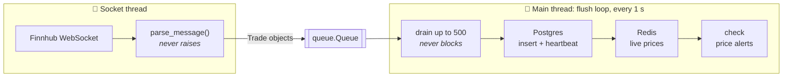

**One flush, step by step.** The order matters: Redis is only updated **after** Postgres has
accepted the batch, so the cache never counts a trade that the database does not have.

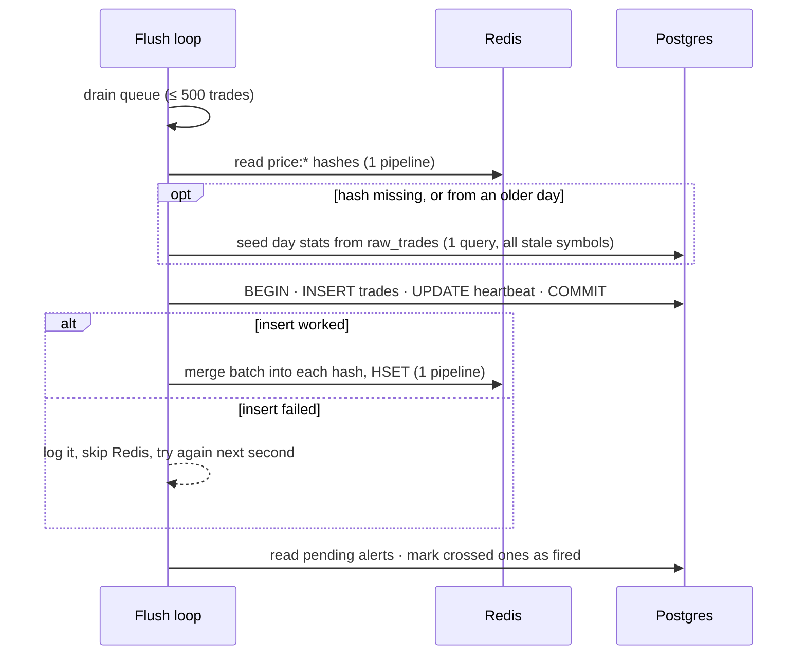

**Staying connected.** When the socket drops, the stream records why, waits, and reconnects. The wait
doubles each time (exponential backoff) with random jitter, so many clients don't all retry at the same moment.

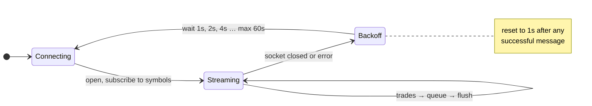

Every connection is logged in `stream_sessions` with a heartbeat on each flush. This lets the dashboard
tell **"the market is quiet"** apart from **"the socket is dead"**.

### 🟥 Redis: the live price cache

Each symbol gets one Redis **hash**. Postgres is still the source of truth. This is a fast copy for the
dashboard, which reads it every second.

```text
redis> HGETALL price:NVDA
 day           2026-10-12
 trade_ts      2026-10-12T14:31:40+00:00
 price         104.0          ← latest trade
 volume        4.0
 day_open      100.0          ← first trade of the day
 day_high      108.0          ← max(old high, batch high)
 day_low       95.0           ← min(old low, batch low)
 trades_today  4              ← old count + batch size
```

How the dashboard reads it, and what happens when Redis is not there:

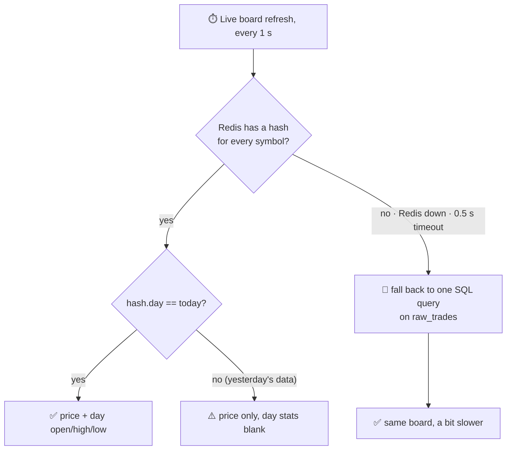

| Design rule | Why |
|---|---|
| **No persistence** (`--save '' --appendonly no`) | Everything can be rebuilt from Postgres. A restart simply starts empty. |
| **0.5 s timeout** on every call | A slow Redis gives up in time and doesn't stall the 1-second flush |
| **One pipeline** per read or write | All five symbols in **one** network round trip |
| **Rebuild after any failure** | If a write fails, the next flush rebuilds day stats from Postgres instead of trusting a hash that may be behind |
| **Bound to `127.0.0.1`** | This Redis has no password, so it is never exposed to the network |

### 🕯️ `rollup`: the transform step

Every 60 seconds the rollup reads the **last 10 minutes** of trades and rebuilds those minutes' candles.
The window is wider than the interval on purpose: a late trade, or a missed run, is picked up next time.

**Worked example** (this exact case is checked by the end-to-end test):

| Time | Symbol | Price | Volume | |
|---|---|---|---|---|
| 14:31:10 | NVDA | **100.0** | 1 | ← first = **open** |
| 14:31:20 | NVDA | **108.0** | 2 | ← max = **high** |
| 14:31:30 | NVDA | **95.0** | 3 | ← min = **low** |
| 14:31:40 | NVDA | **104.0** | 4 | ← last = **close** |

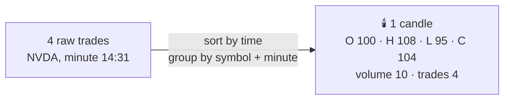

The write is an **upsert** (`INSERT … ON CONFLICT (symbol, minute) DO UPDATE`), so running the same
minute twice gives exactly the same row. Every run is logged in `rollup_runs` with its status and row counts.

### 🔐 `api`: FastAPI

| Method | Path | Who can call it | What it does |
|---|---|---|---|
| `GET` | `/health` | anyone | Liveness check |
| `POST` | `/auth/register` | anyone | Creates a `user` account (`409` if the email exists) |
| `POST` | `/auth/login` | anyone | Checks the password, returns a JWT |
| `GET` | `/candles?symbol=NVDA&hours=1` | signed in | One-minute candles, 1–24 hours back |
| `POST` | `/alerts` | signed in | Creates a price alert owned by the caller |
| `GET` | `/alerts` | signed in | Users see **their own** alerts; admins see **all** |
| `DELETE` | `/alerts/{id}` | **admin only** | Deletes an alert (`403` for normal users) |

Interactive docs are generated automatically at **http://localhost:8000/docs**.

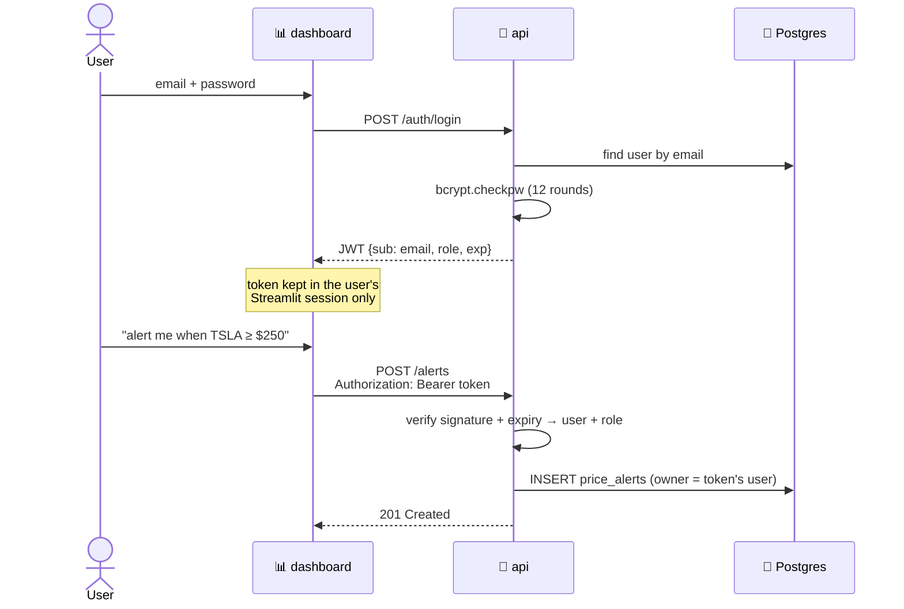

**Security details**
- Passwords are hashed with **bcrypt** (salted, 12 rounds). The plain password is never stored.
- JWTs are **HS256**, and must contain `sub`, `role` and `exp`. The API **refuses to start** if `JWT_SECRET` is missing or shorter than 32 characters.
- Emails are trimmed and lower-cased before they are stored, so one person can't own two accounts that differ only in case.
- Input is validated by **Pydantic** models: email pattern, password length, `above`/`below` direction, a positive threshold.
- All SQL uses **bound parameters**. No string concatenation.
- No default admin password. The admin account is only created if you set **both** email and password.

### 📊 `dashboard`: Streamlit

| Page | What you see | Refresh |
|---|---|---|
| 📈 **Markets** | A price card per symbol (price, % change since open, sparkline) and a **Plotly candlestick chart** with 1h / 6h / 24h ranges | cards **1 s** (from Redis), chart **30 s** |
| 🔔 **Alerts** | Create alerts, see "Watching" and "Fired" counts, admins can delete | on action |
| 🛠️ **Pipeline** | A health strip *Finnhub → stream → raw_trades → rollup → candles → dashboard*, with ✅/⚠️ for each stage plus session and run logs | on load |

The dashboard uses `st.fragment(run_every=...)` so that only the part of the page that needs to change
is redrawn. The cards refresh every second; the heavier chart refreshes every 30 seconds. Closed-market
hours are cut out of the chart axis, so a 24-hour view isn't mostly empty space.

---

## 🗄 Data model

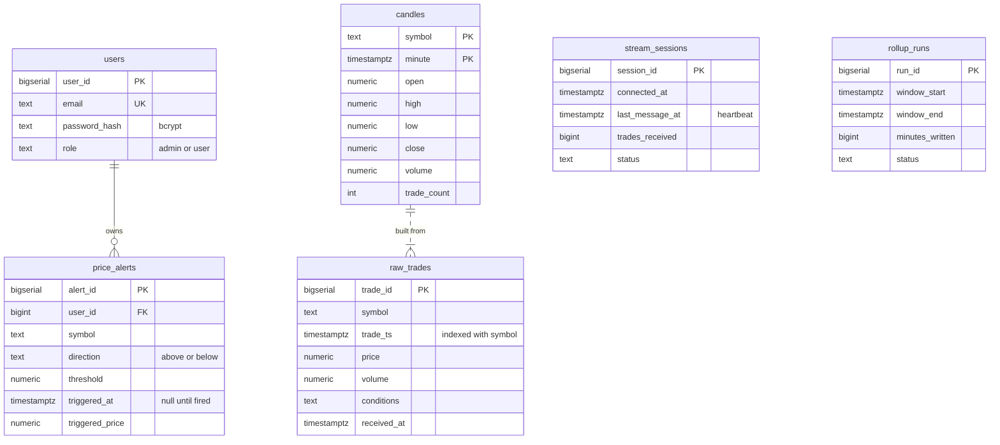

Each service creates **its own tables** at start-up (`CREATE TABLE IF NOT EXISTS`). No service depends on
another one having started first. Prices are stored as `NUMERIC`, not `FLOAT`, so money values are exact.

---

## 🧠 Engineering decisions

These are the choices I would talk about in an interview.

| Decision | What it means in practice |
|---|---|
| **Idempotent writes** | Candle upserts and the Redis merge rules (max/min/keep-first) give the same result if they run twice. A crash and a re-run never double-count. |
| **Failure isolation** | Redis down? The board falls back to Postgres. Market-status API down? The stream keeps streaming. An alert check fails? Trades are still saved. One broken part never stops the others. |
| **One source of truth** | Postgres owns the data. Redis is updated **only after** a successful insert, and is rebuilt from Postgres whenever it might be wrong. |
| **Fail fast on bad config** | Every service validates its settings at start-up and exits with a clear message. The rollup even refuses a window shorter than its interval, because minutes would be silently skipped. |
| **Pure core, thin shell** | Candle building, alert matching, Redis merging, backoff and message parsing are pure functions with no database and no clock. That's why they're easy to unit test. |
| **Immutable data** | `Trade`, `ExponentialBackoff`, configs and users are `frozen` dataclasses. Functions return new values instead of changing old ones. |
| **Observable by design** | `stream_sessions` and `rollup_runs` record every connection and run, so the Pipeline page can show the health of each stage without reading container logs. |
| **One secret, one place** | One Postgres password in `.env`. Compose passes it to every service. Nothing to keep in sync. |

---

## 🧪 Testing

About **400 tests** across three tiers. Each tier tests something the tier below can't.

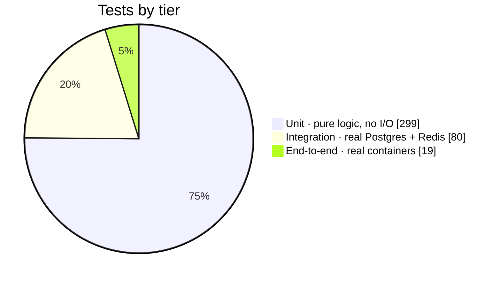

| Service | Unit | Integration | What's covered |
|---|---:|---:|---|
| `api` | 121 | 38 | routes, auth, tokens, passwords, validation, SQL queries |
| `stream` | 98 | 28 | parsing, buffering, backoff, alerts, Redis merge and round trip, day-stats SQL |
| `dashboard` | 49 | 3 | status rules, API client, Redis reader, candle SQL |
| `rollup` | 31 | 11 | candle maths, config validation, upsert idempotency |
| **e2e** | | **19** | the whole system, wired as in production |

**How the end-to-end test works.** It starts the **real Docker images** with Testcontainers. The real
Finnhub is swapped for a small fake WebSocket server written in `aiohttp`, which sends a known burst of trades.
The test then checks every hop:

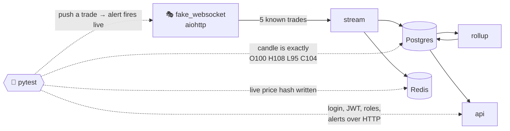

Some test design choices:
- **Integration tests roll back.** Each test runs inside a transaction that is always rolled back, so no test can leak rows into another.
- **The e2e stack is isolated.** It uses its own Compose project name and random host ports, so your dev database is never touched.
- **Integration tests skip, not fail, when no database is running locally.** In CI, a pre-check makes the job **fail** if Postgres or Redis is unreachable, so a green job always means the tests really ran.

---

## 🚦 CI/CD pipeline

GitHub Actions runs on every push to `main`. After linting, the pipeline splits into **one lane per
container**. Each lane is the same reusable workflow (`service-tests.yml`). End-to-end runs only when all
four lanes pass.

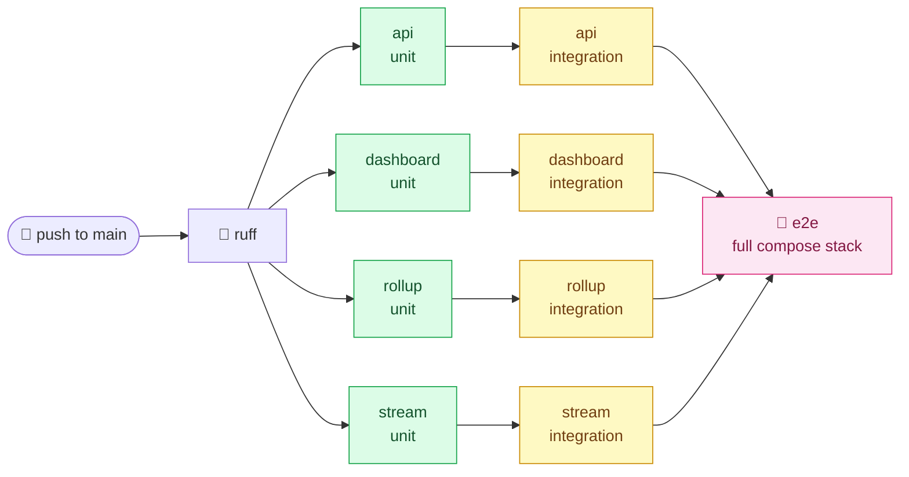

- **Integration jobs** get real `postgres:13` and `redis:7-alpine` **service containers**.
- Each job publishes **JUnit results** as a check, and writes a **coverage line** plus the 10 slowest tests to the job summary (`scripts/test_summary.py`).
- The lanes are separate jobs rather than a matrix, so each one shows up as its own box in the Actions graph.

---

## 🚀 Run it yourself

**You need:** Docker Desktop and a free API key from [finnhub.io](https://finnhub.io).

```bash
git clone https://github.com/siarkonyar/elt-dbt-phyton-data-pipeline.git
cd elt-dbt-phyton-data-pipeline
cp .env.example .env
```

Open `.env` and fill in these four values:

| Variable | What to put |
|---|---|
| `POSTGRES_PASSWORD` | any password |
| `FINNHUB_API_KEY` | your Finnhub key |
| `JWT_SECRET` | output of `openssl rand -hex 32` |
| `API_ADMIN_PASSWORD` | a password for the admin account (`admin@example.com`) |

Then start everything:

```bash
docker compose up --build
```

| Open | URL |
|---|---|
| 📊 Dashboard | http://localhost:8501 |
| 📘 API docs (Swagger) | http://localhost:8000/docs |
| 🐘 Postgres | `localhost:5434` · user `postgres` · db `destination_db` |
| 🟥 Redis | `localhost:6379` |

> 🕐 **Trades arrive mainly while the US market is open** (9:30–16:00 New York time, weekdays).
> Outside those hours the dashboard shows the last stored prices, and the Pipeline page shows when the last message arrived.

### Running the tests

```bash
python -m venv .venv && source .venv/bin/activate
pip install -r requirements-dev.txt

# 1. Unit tests: no Docker needed
pytest tests/unit

# 2. Integration tests: need the compose Postgres + Redis and a test database
docker compose up -d destination_postgres redis
docker compose exec destination_postgres createdb -U postgres test_db
pytest tests/integration

# 3. End-to-end: builds and runs every image (takes a few minutes)
pytest -m e2e

# Lint
ruff check .
```

---

## ⚙️ Configuration

All settings come from environment variables (`.env`). Each service checks them at start-up.

| Variable | Default | Used by | Meaning |
|---|---|---|---|
| `FINNHUB_API_KEY` | **required** | stream | Finnhub key |
| `POSTGRES_PASSWORD` | **required** | all | The one database password |
| `JWT_SECRET` | **required**, ≥ 32 chars | api | Signs login tokens |
| `STOCK_SYMBOLS` | `AMZN,NVDA,GOOGL,TSLA,NFLX` | stream | Symbols to subscribe to |
| `REDIS_URL` | `redis://redis:6379/0` | stream, dashboard | Live price cache |
| `FLUSH_INTERVAL_SECONDS` | `1` | stream | How often the queue is written |
| `FLUSH_MAX_ROWS` | `500` | stream | Max trades per flush |
| `RECONNECT_MIN_SECONDS` / `MAX` | `1` / `60` | stream | Reconnect backoff range |
| `STALE_AFTER_SECONDS` | `90` | stream, dashboard | Silence before the feed counts as stale |
| `ROLLUP_INTERVAL_SECONDS` | `60` | rollup | How often candles are rebuilt |
| `ROLLUP_WINDOW_MINUTES` | `10` | rollup | How far back each run looks |
| `JWT_EXPIRY_SECONDS` | `3600` | api | Token lifetime |
| `API_ADMIN_EMAIL` / `PASSWORD` | blank | api | Seed admin, created only if both are set |
| `API_BASE_URL` | `http://api:8000` | dashboard | Where the dashboard calls the api |
| `HISTORY_HOURS` | `24` | dashboard | Widest chart range |

---

## 🗂 Project structure

```text
elt/
├── stream/                  ⚡ Extract + Load: Finnhub → Postgres + Redis
│   ├── main.py              │  flush loop, reconnect loop, alert checks
│   ├── socket_client.py     │  WebSocket thread + message parsing
│   ├── live_prices.py       │  Redis hash merge, read, write
│   ├── alerts.py            │  which alerts a batch of trades crossed
│   ├── backoff.py           │  exponential backoff with jitter
│   ├── market_status.py     │  Finnhub REST: is the market open?
│   └── buffer.py · writer.py · db.py · config.py · schema.sql
├── rollup/                  🕯️ Transform: trades → 1-minute candles
│   ├── candles.py           │  pure pandas OHLCV aggregation
│   ├── writer.py            │  idempotent upsert + run log
│   └── main.py · db.py · config.py · schema.sql
├── api/                     🔐 FastAPI: auth, candles, alerts
│   ├── main.py              │  routes + start-up lifespan
│   ├── auth.py · tokens.py · passwords.py · emails.py
│   └── db.py · queries.py · serialize.py · config.py · schema.sql
├── dashboard/               📊 Streamlit
│   ├── app.py               │  sign-in + page navigation
│   ├── views/               │  markets.py · alerts.py · pipeline.py
│   ├── live_prices.py       │  Redis reader with Postgres fallback
│   └── data.py · queries.py · status.py · auth.py · ui.py
├── tests/
│   ├── unit/<service>/          🟢 pure logic
│   ├── integration/<service>/   🟡 real Postgres + Redis
│   └── e2e/                     🔴 real containers + fake Finnhub
├── .github/workflows/       🚦 ci.yml + reusable service-tests.yml
├── docs/superpowers/specs/  📝 design docs written before building
├── docker-compose.yaml
└── .env.example
```

---

## 🔭 Known limits and next steps

Honest notes on where this would need work at a larger scale:

- **Candle maths runs in pandas.** That's fine for five symbols and a 10-minute window. At hundreds of symbols the aggregation should move into a SQL `GROUP BY` inside Postgres.
- **The dashboard's symbol list is a constant** that has to match `STOCK_SYMBOLS` in the stream. A shared config would remove that manual step.
- **Redis has no password or TLS.** That's fine because it's bound to localhost. A cloud deployment would need both, or a managed Redis.
- **`raw_trades` grows forever.** Partitioning by day, or a retention job, would keep it bounded.

---

<div align="center">

Built by **[Siar Konyar](https://github.com/siarkonyar)** · Python · PostgreSQL · Redis · FastAPI · Streamlit · Docker · GitHub Actions

</div>
